# EV ChargeOps — O carregador como porta de entrada do ecossistema GoodWe

**Enterprise Challenge 2026 — GoodWe x FIAP**
Sprint 02 — Desenvolvimento e prototipação

**Integrante:** Vitor Kubica Silveira (RM 573465)

O EV ChargeOps é um aplicativo para condomínios com carregadores compartilhados de veículos elétricos. Ele registra cada recarga, calcula o consumo de cada morador, divide a conta de forma justa e usa inteligência artificial para proteger a fatura e orientar o gestor. O diferencial é mostrar, em cada recarga, **de onde veio a energia do carro**: do sol do prédio, da bateria GoodWe ou da rede. Isso só funciona com inversor e bateria GoodWe, e é o que transforma o carregador em porta de entrada para vender o ecossistema completo.

Este repositório tem duas partes: a **implementação da Sprint 02** (este topo do README) e a **documentação da Sprint 01** (a partir da seção "Documentação da Sprint 01"), mantida porque o protótipo segue o que foi planejado lá.

## Vídeo pitch

Demonstração do projeto em vídeo: [https://youtu.be/lOodSFOxlbk](https://youtu.be/lOodSFOxlbk)

[](https://youtu.be/lOodSFOxlbk)

## Sumário

1. [O que foi implementado](#1-o-que-foi-implementado)
2. [Como executar](#2-como-executar)
3. [Estrutura do código](#3-estrutura-do-código)
4. [A lógica central](#4-a-lógica-central)
5. [Como a IA entra no fluxo](#5-como-a-ia-entra-no-fluxo)
6. [Decisões técnicas](#6-decisões-técnicas)
7. [Desvios em relação à Sprint 01](#7-desvios-em-relação-à-sprint-01)
8. [Limitações conhecidas](#8-limitações-conhecidas)
9. [Evidências de funcionamento](#9-evidências-de-funcionamento)
10. [Documentação da Sprint 01](#documentação-da-sprint-01)

---

## 1. O que foi implementado

O app tem duas visões no mesmo aplicativo (sem login: ele usa um morador fixo, Vitor Kubica, com dois apartamentos e dois carros).

**Morador**

- **Início:** leitor de QR code no topo (câmera via `expo-camera`), a economia do morador com a infra do prédio, uma dica personalizada e a lista de carregadores do prédio. Ler o QR de um carregador livre pede o carro e começa a recarga, com a origem da energia ao vivo. Se o carregador estiver em uso, o app explica o erro, indica um livre e oferece o botão Voltar.
- **Perfil** (pelo avatar no topo): cadastro, apartamentos (mais de um) e carros. Cada carro pode ser conectado ao app da montadora para mostrar bateria e autonomia.
- **Recargas e fatura (na mesma página):** economia do mês frente ao eletroposto público, fatura por origem da energia, divisão por apartamento e a lista de recargas. Cada recarga abre o detalhe "De onde veio a energia do seu carro".

**Gestor**

- Economia dos moradores com o sistema compartilhado.
- Recargas retidas pela IA, com botões para liberar ou descartar a cobrança.
- Horários de pico e sobrecarga contra o limite do circuito, ocupação dos carregadores, esperas e desistências.
- Distribuição da energia por origem, por carregador e por morador.
- Comparação de investimento: quanto custa atender mais moradores com carregadores compartilhados ou com um carregador por morador.
- Perfis de uso, quem puxa da rede e previsão de ocupação para 7 dias.

## 2. Como executar

Requisitos: Node 22 ou superior e, para o app, o Expo Go ou um simulador iOS/Android.

```bash
npm install
npm run api       # API em http://localhost:3333 (compila o shared antes)
npm run mobile    # Expo: aperte "i" para o simulador iOS ou leia o QR code no Expo Go
```

```bash
npm test          # 19 testes do pacote shared (origem da energia, rateio, capacidade e IA)
npm run typecheck # confere os tipos dos três pacotes
```

A API leva alguns segundos para subir porque gera 90 dias de histórico simulado. Em celular físico, o app descobre o endereço da API pelo IP da máquina que serve o Expo. Para outro endereço, defina `EXPO_PUBLIC_API_URL`.

## 3. Estrutura do código

Monorepo com Turborepo (npm workspaces).

```
apps/mobile        App React Native (Expo + expo-router): telas, tema e componentes
apps/api           API Fastify + TypeScript: rotas e dados simulados
packages/shared    Regras de negócio em TypeScript, sem dependência de framework
```

| Arquivo | O que faz |
|---|---|
| `packages/shared/src/energy.ts` | Divide a potência do carregador entre sol, bateria e rede a cada amostra da planta |
| `packages/shared/src/billing.ts` | Rateio por kWh com componente de demanda e taxa fixa; economia por sessão |
| `packages/shared/src/ai.ts` | Os três módulos de IA: anomalias, perfis de uso e previsão de ocupação |
| `packages/shared/src/capacity.ts` | Quantos moradores a infra comporta e quanto custa expandir |
| `packages/shared/src/api.ts` | Contrato HTTP (só tipos) entre a API e o app |
| `apps/api/src/mock.ts` | Planta solar, bateria, 12 moradores e 90 dias de recargas, de forma determinística |
| `apps/api/src/server.ts` | Rotas: carregadores, recarga ao vivo, perfil, atividade e gestor |
| `apps/mobile/app/` | Telas (Início, Recargas e fatura, Gestor, Evidências, Perfil, detalhe da recarga) |
| `apps/mobile/src/theme.ts` | Tokens do design system Charge DS (cores, espaçamento, tipografia, modo escuro) |

## 4. A lógica central

**Origem da energia.** A cada amostra da planta (geração solar, bateria, rede e consumo do prédio), a potência do carregador é atribuída em cascata: primeiro o excedente solar (geração menos o consumo base do prédio), depois a bateria, e só então a rede. A soma de sol, bateria e rede é sempre igual à energia entregue. É uma estimativa por balanço de potência, não uma medição física por elétron.

**Rateio.** Segue a fórmula da Sprint 01:

```
fatura = (kWh do morador / kWh total) x custo de energia
       + (pico do morador / soma dos picos) x custo de demanda
       + taxa da plataforma / moradores ativos
```

O condomínio escolhe entre tarifa única por kWh ou tarifa por origem (sol R$ 0,30, bateria R$ 0,55 e rede R$ 0,95 por kWh, valores de exemplo). Na tarifa por origem, quem carrega com o sol paga menos, e a economia fica visível. Quem não carregou no ciclo não aparece na fatura, e a taxa fixa só é dividida entre moradores ativos.

**Economia do morador.** É o quanto ele deixou de gastar em relação a um eletroposto público (R$ 2,10 por kWh, valor de exemplo), já descontando o que pagou.

**Capacidade e investimento.** A partir da ocupação no horário de pico, estima-se quantos moradores a infra comporta com folga (pico de 80%). Os moradores além disso, incluindo a fila de espera, definem quantos carregadores faltam. O custo é comparado com um carregador individual por morador, e o app mostra a partir de quantos moradores novos o compartilhado passa a ser sempre mais barato.

## 5. Como a IA entra no fluxo

A IA não é um relatório à parte: cada módulo muda algo que o morador ou o gestor vê e paga.

| Módulo | Técnica | Onde decide algo |
|---|---|---|
| IA 1: anomalias | Z-score robusto (mediana e MAD) sobre kWh por hora e duração, com base de cada morador, mais regras de domínio | **Decide o que entra na fatura.** Falha do carregador e leitura absurda de energia ficam retidas até o gestor liberar ou descartar. |
| IA 2: perfis de uso | K-Means sobre horário, duração, frequência e energia por recarga | Vira a dica do morador e mostra ao gestor qual perfil puxa mais energia da rede, para direcionar o incentivo ao horário solar. |
| IA 3: previsão de ocupação | Média sazonal por dia da semana e hora, sobre as últimas 8 semanas | Vira a dica "melhor hora para carregar com o sol" do morador e a previsão de 7 dias do gestor. |

**IA 1 em detalhe.** A função `detectAnomalies` (`packages/shared/src/ai.ts`) devolve, para cada recarga suspeita, o tipo (`falha`, `medicao`, `ociosa` ou `curta`) e se ela deve reter a cobrança (`holdBilling`). A API (`apps/api/src/server.ts`) usa esse resultado em um único ponto, `billable()`, que filtra as sessões antes de qualquer fatura, rateio ou total do gestor. Por isso, a decisão do gestor muda os números de verdade: nas evidências, descartar uma leitura de 136 kWh em 2 horas reduziu o faturado de R$ 2.683,84 para R$ 2.568,34. Carro parado conectado ou recarga curta não retêm a cobrança, porque o kWh deles é pequeno e correto.

**Por que a base é de cada morador.** Com uma base única, quem carrega rápido sempre (11 kW) era marcado como suspeito toda vez. Comparar cada recarga com o histórico do próprio morador eliminou esses falsos alarmes (há teste para isso em `ai.test.ts`).

## 6. Decisões técnicas

- **Regras de negócio no pacote `shared`, sem framework.** A API e o app usam o mesmo código, e tudo é testável sem subir servidor.
- **Tipos como contrato.** `packages/shared/src/api.ts` descreve cada resposta da API; se um lado mudar, o outro deixa de compilar.
- **Dados simulados determinísticos.** O gerador usa uma semente fixa, então os resultados e os testes são reproduzíveis. As falhas e leituras absurdas são plantadas de propósito para a IA ter o que achar.
- **IA em TypeScript e explicável.** Cada técnica cabe em poucas dezenas de linhas, com testes, e o gestor entende o motivo de cada alerta (as mensagens dizem o que foi visto).
- **Uma única fonte para as evidências.** A aba "Evidências" do app e a seção 9 deste README leem da mesma lista (`apps/mobile/src/evidencias.ts`).
- **Linguagem do app.** Frases curtas, sem jargão ("Algo estranho nessa recarga, quer conferir?"), como definido no design system.

## 7. Desvios em relação à Sprint 01

Comparação com o que foi entregue na Sprint 01 (README original do repositório):

| Planejado na Sprint 01 | No protótipo | Justificativa |
|---|---|---|
| Collector lendo a API SEMS a cada 60 s | Planta solar e bateria simuladas (`apps/api/src/mock.ts`) | A leitura do fluxo da planta no SEMS não foi validada no equipamento da FIAP (era o risco principal). O algoritmo de origem da energia é o real e recebe amostras no formato que o SEMS entregaria. |
| PostgreSQL (Supabase) | Dados em memória; reiniciar a API restaura o histórico | Foco em validar regras e experiência. O esquema da seção 5.5 da documentação da Sprint 01 continua sendo o alvo da persistência. |
| IA em Python (Isolation Forest ou LSTM, K-Means, Prophet) | IA em TypeScript: z-score robusto com regras, K-Means e média sazonal | Evita um segundo serviço no protótipo e mantém cada técnica explicável. O K-Means segue o plano. Isolation Forest e Prophet pedem mais histórico real do que o simulado. |
| Painel do gestor em Next.js | Aba "Gestor" no mesmo app | Reaproveita o design system e a API em um único protótipo. |
| Deploy (Fly.io e Vercel) e Datadog | Execução local | O protótipo roda na máquina do avaliador; deploy e observabilidade ficam para a versão com dados reais. |
| Endpoints `POST /billing-cycles/:id/close` e `GET /invoices/:user_id` | `GET /activity` (fatura do ciclo) e `GET /manager/overview` | A fatura é calculada sob demanda para o ciclo escolhido, sem um fechamento explícito. A retenção de cobrança pela IA e a decisão do gestor cumprem o papel do "gestor aprova antes de cobrar". |
| Agendamento de recarga e notificações push no app do usuário | Não implementados | Foram trocados por itens de maior valor para a proposta: leitura de QR, perfil com carros e economia. A previsão de ocupação já indica o melhor horário. |
| Um carregador HCA G2 (FIAP) | 4 carregadores, 12 moradores e fila de espera simulados | O argumento de capacidade e investimento do gestor só aparece com mais de um carregador. |
| App do usuário e painel com abordagem de backoffice genérico | Abordagem de ecossistema GoodWe: origem da energia, economia e investimento | Reposicionamento descrito no início da documentação da Sprint 01 deste README. |

## 8. Limitações conhecidas

- **Dados simulados.** As conclusões do painel (pico às 20h, sobrecarga, fila) valem para os dados gerados, não para um prédio real. O pico noturno foi desenhado para existir.
- **Valores de exemplo, não reais:** tarifas por origem, eletroposto público (R$ 2,10 por kWh), limite do circuito (22 kW), carregador compartilhado instalado (R$ 18.000) e carregador individual com obra (R$ 8.500).
- **Origem da energia é estimativa.** Depende da resolução dos dados da planta e de a leitura estar disponível via SEMS.
- **Leitura de QR.** O simulador iOS não tem câmera; nas evidências, a leitura foi demonstrada tocando no carregador. Em celular físico a câmera lê o QR, mas isso não foi testado.
- **Integração com montadoras.** É simulada (sem login real). A versão real exige acordo e API de cada montadora.
- **Sem login e sem persistência.** Existe um único morador fixo e o estado volta ao inicial quando a API reinicia.

## 9. Evidências de funcionamento

Capturas do protótipo rodando no iPhone 17 (simulador iOS) com a API local. Elas também estão na aba **Evidências** do app, e os arquivos ficam em `apps/mobile/assets/evidencias/`.

- 25 capturas, do QR code ao painel do gestor.
- 19 testes automatizados passando (`npm test`) e build e typecheck dos 3 pacotes sem erros (`npm run typecheck`).

### Início e leitura do QR code

<table>
<tr>
<td valign="top" width="50%"><b>Início: leitor de QR no topo</b><br><sub>Leitor de QR code e a economia do morador. O simulador não tem câmera, então o app avisa; em celular a leitura é real.</sub><br>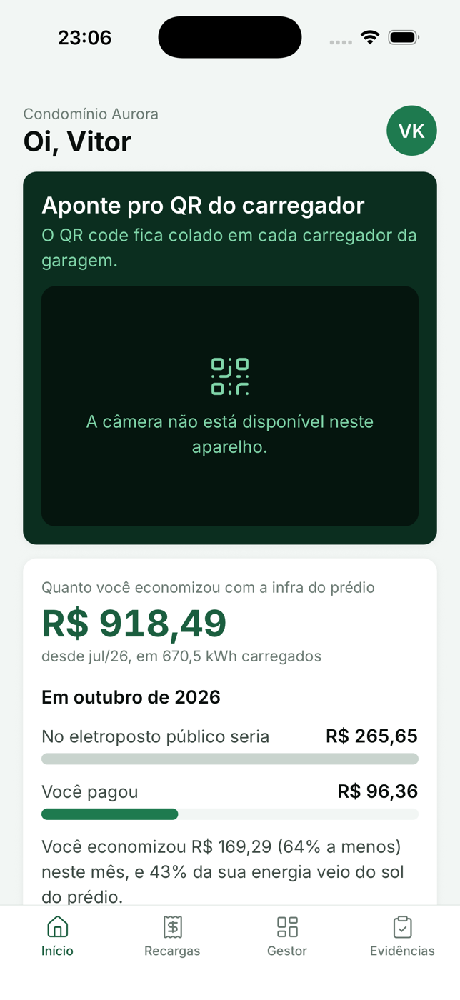</td>
<td valign="top" width="50%"><b>Dica do morador (IA 2 e IA 3)</b><br><sub>O perfil de uso do morador (K-Means) e a previsão de ocupação de amanhã viram uma dica: "Carrega com o sol" e a melhor hora para carregar.</sub><br>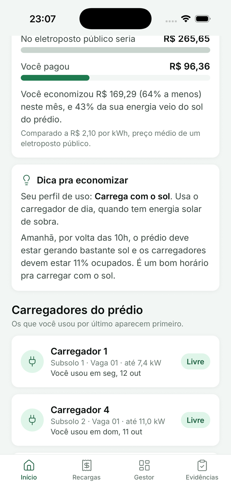</td>
</tr>
<tr>
<td valign="top" width="50%"><b>Carregadores do prédio</b><br><sub>Lista com os usados por último primeiro. O Carregador 2 aparece em uso por outro morador.</sub><br>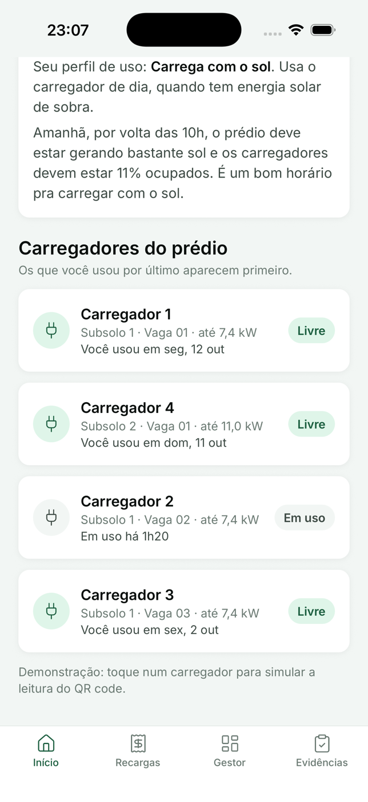</td>
<td valign="top" width="50%"><b>Erro na leitura, com botão Voltar</b><br><sub>QR de um carregador em uso: o app explica, indica um carregador livre e oferece o botão Voltar.</sub><br>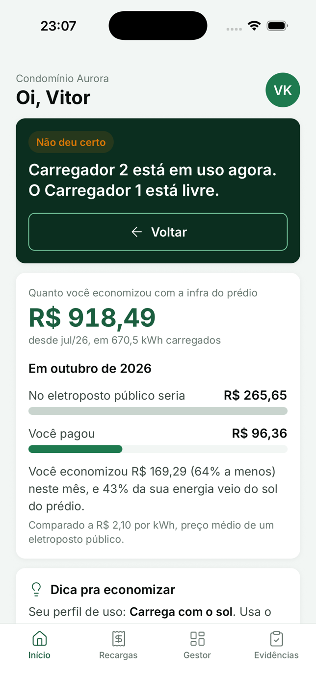</td>
</tr>
<tr>
<td valign="top" width="50%"><b>QR lido: escolher o carro</b><br><sub>Ao ler o QR de um carregador livre, o app pergunta qual carro vai carregar (o morador tem dois).</sub><br>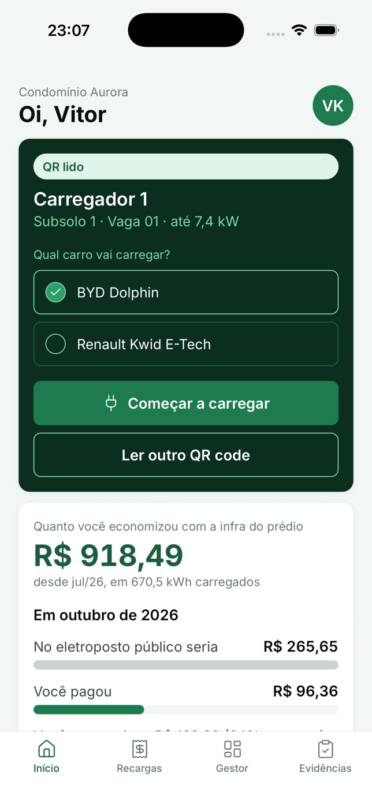</td>
<td width="50%"></td>
</tr>
</table>

### Recarga e origem da energia

<table>
<tr>
<td valign="top" width="50%"><b>Carregando agora</b><br><sub>Recarga ao vivo no Carregador 1 com o BYD Dolphin: 100% da energia vinda do sol nos primeiros minutos.</sub><br>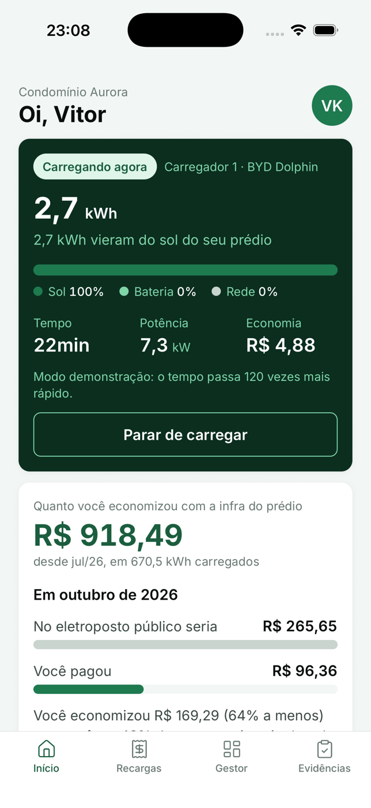</td>
<td valign="top" width="50%"><b>Origem mudando ao longo do dia</b><br><sub>Com a tarde avançando na simulação, a rede e a bateria entram na mistura (66% sol, 3% bateria, 31% rede).</sub><br>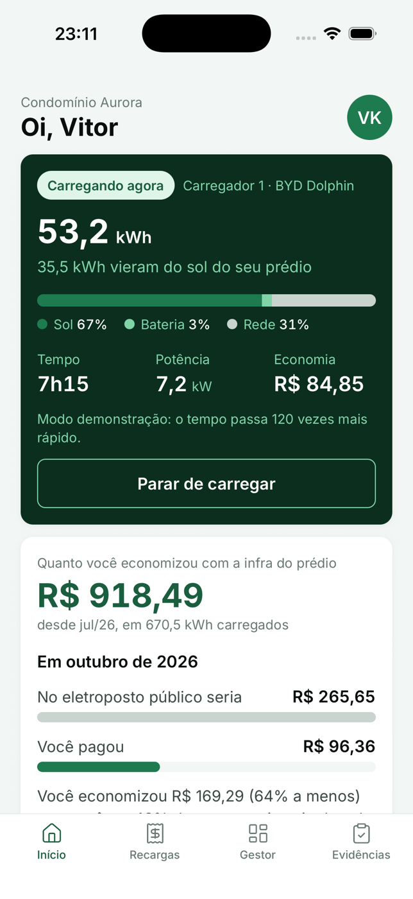</td>
</tr>
<tr>
<td valign="top" width="50%"><b>De onde veio a energia do seu carro</b><br><sub>Detalhe da recarga: kWh de sol, bateria e rede, quanto custou e quanto o morador economizou frente ao eletroposto público.</sub><br>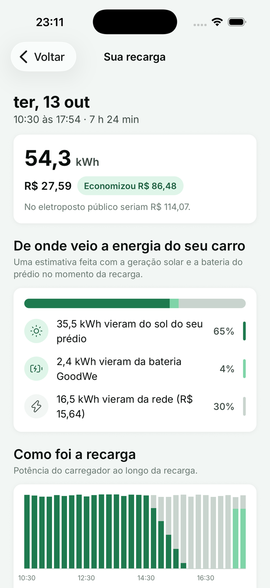</td>
<td width="50%"></td>
</tr>
</table>

### Perfil

<table>
<tr>
<td valign="top" width="50%"><b>Cadastro</b><br><sub>Dados do morador, abertos pelo avatar no topo da Início.</sub><br>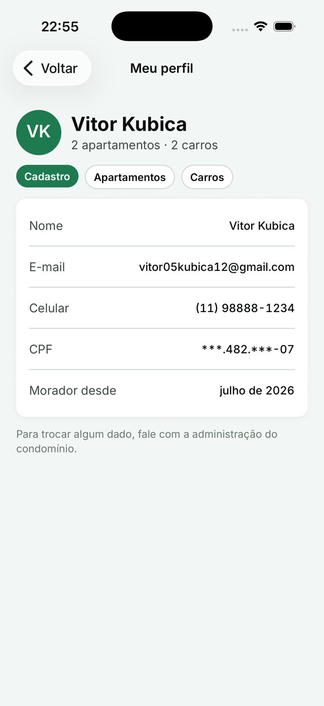</td>
<td valign="top" width="50%"><b>Apartamentos</b><br><sub>O morador tem dois apartamentos (proprietário e inquilino) e pode adicionar outros.</sub><br>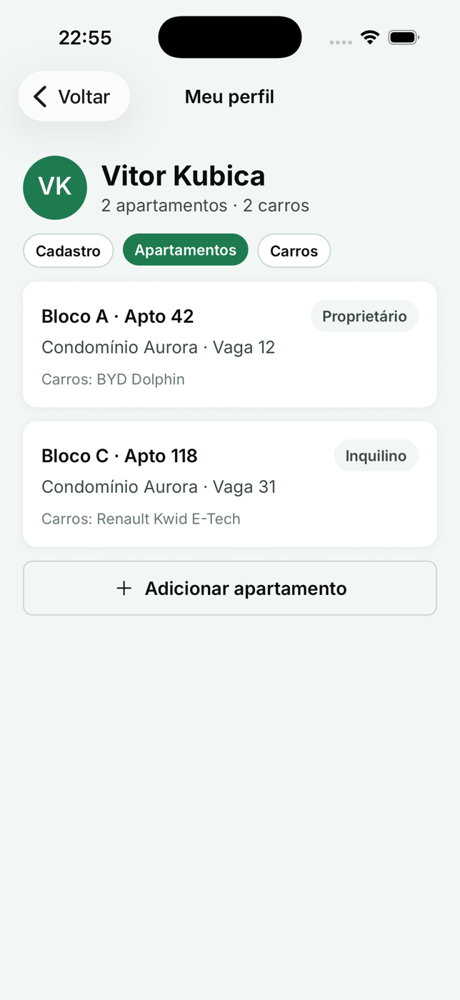</td>
</tr>
<tr>
<td valign="top" width="50%"><b>Carros e integração</b><br><sub>BYD já conectada ao app da montadora (bateria e autonomia). A Renault pode ser conectada pelo botão.</sub><br>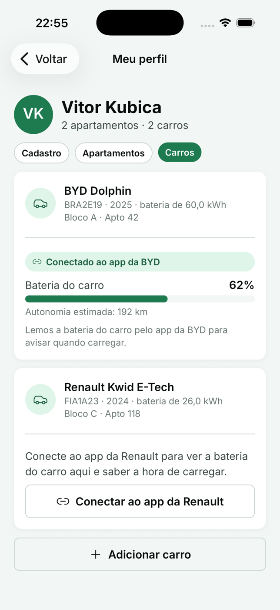</td>
<td valign="top" width="50%"><b>Carro conectado</b><br><sub>Depois de conectar o Renault, o app passa a mostrar a bateria dele também.</sub><br>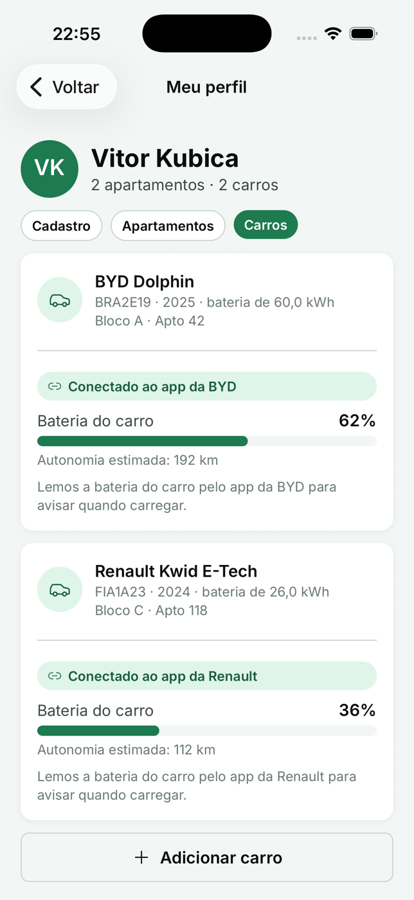</td>
</tr>
</table>

### Recargas e fatura

<table>
<tr>
<td valign="top" width="50%"><b>Economia, aviso de revisão e fatura (IA 1)</b><br><sub>Recargas e fatura na mesma página. A IA reteve uma recarga com falha do carregador: ela não entra na fatura até o gestor conferir.</sub><br>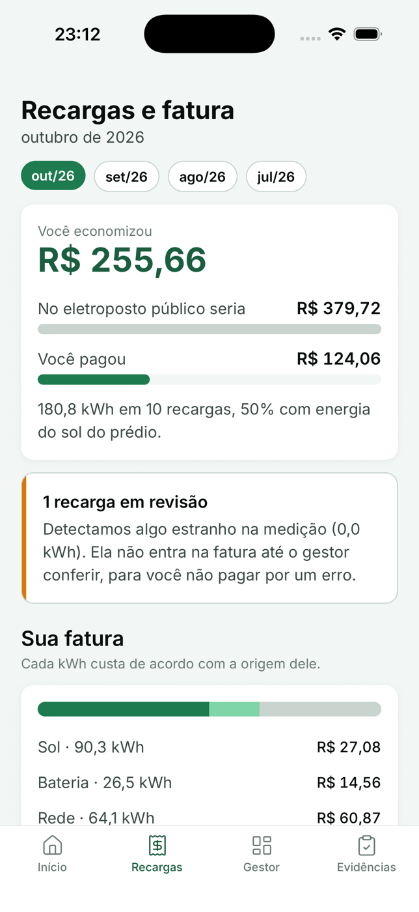</td>
<td valign="top" width="50%"><b>Fatura por apartamento</b><br><sub>A fatura é dividida pelo carro que carregou. A recarga feita ao vivo já aparece no topo da lista.</sub><br>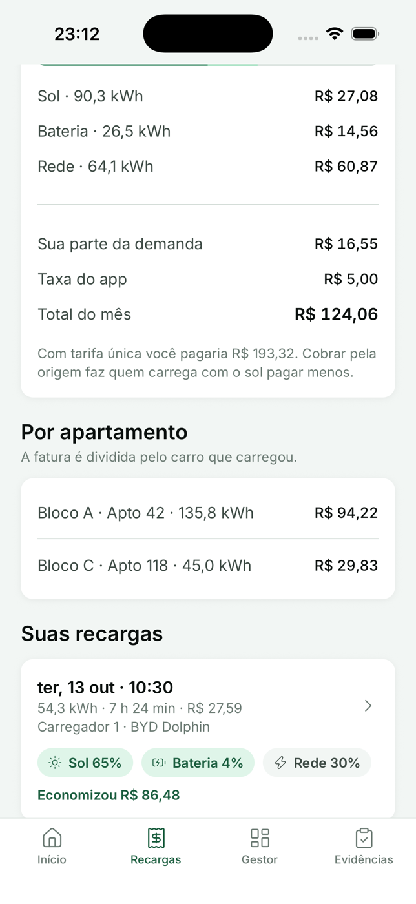</td>
</tr>
<tr>
<td valign="top" width="50%"><b>Recarga em revisão</b><br><sub>A recarga retida pela IA fica marcada como "Em revisão" na lista do morador.</sub><br>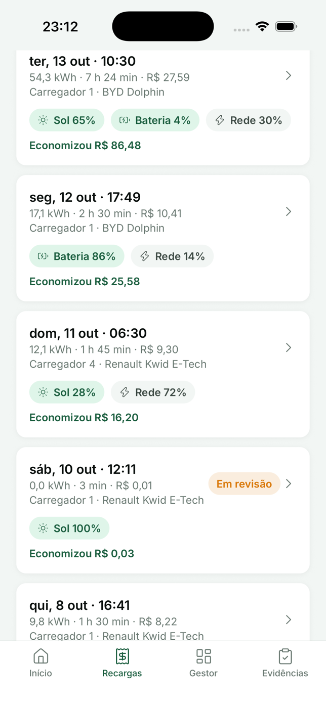</td>
<td width="50%"></td>
</tr>
</table>

### Painel do gestor

<table>
<tr>
<td valign="top" width="50%"><b>Economia e cobrança retida</b><br><sub>Economia dos moradores com o sistema compartilhado e o primeiro alerta: recargas retidas pela IA antes de cobrar.</sub><br>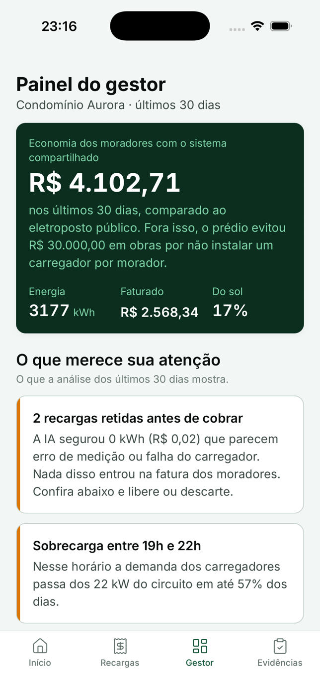</td>
<td valign="top" width="50%"><b>Insights</b><br><sub>Sobrecarga, saturação e a conta de expansão: o que a infra atual não comporta e quanto custa atender a fila.</sub><br>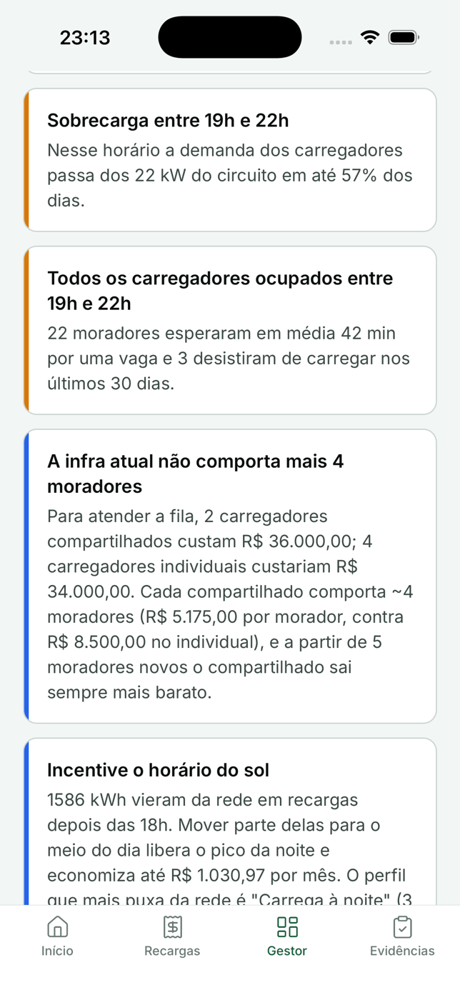</td>
</tr>
<tr>
<td valign="top" width="50%"><b>Horários de pico e sobrecarga</b><br><sub>Demanda simultânea por hora contra o limite do circuito (barras laranja passaram dele) e ocupação dos carregadores.</sub><br>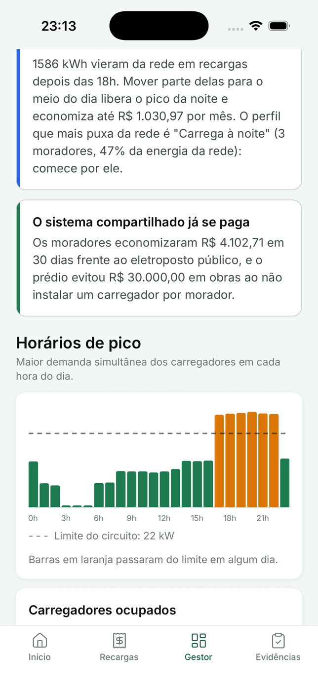</td>
<td valign="top" width="50%"><b>Ocupação e origem da energia</b><br><sub>Esperas e desistências por falta de vaga, e o mix de energia dos últimos 14 dias.</sub><br>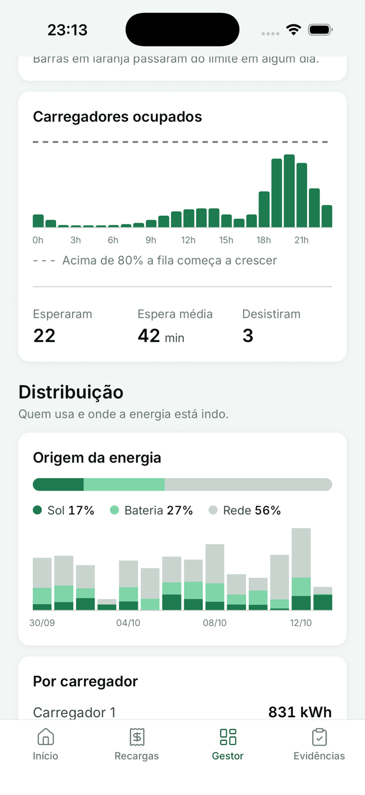</td>
</tr>
<tr>
<td valign="top" width="50%"><b>Distribuição por carregador e morador</b><br><sub>Uso de cada carregador e quem mais consome energia.</sub><br>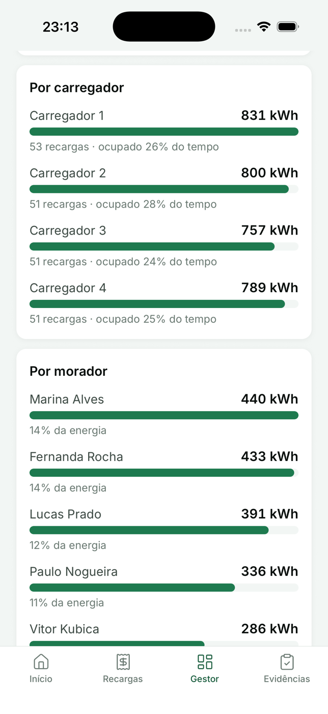</td>
<td valign="top" width="50%"><b>Vale investir em mais carregadores?</b><br><sub>Capacidade atual contra a fila de espera e a comparação de custo entre carregadores compartilhados e individuais.</sub><br>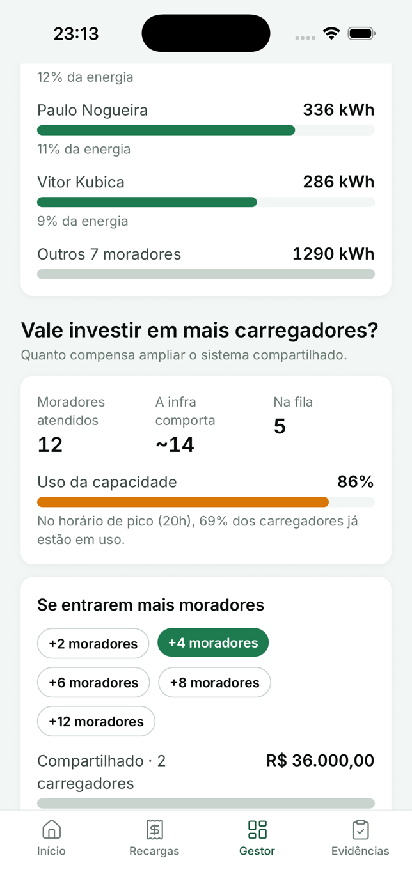</td>
</tr>
<tr>
<td valign="top" width="50%"><b>IA 1: recarga retida para conferir</b><br><sub>Leitura de 136 kWh em 2h, fisicamente impossível para o carro: a IA segura a cobrança (R$ 115,51) até o gestor liberar ou descartar.</sub><br>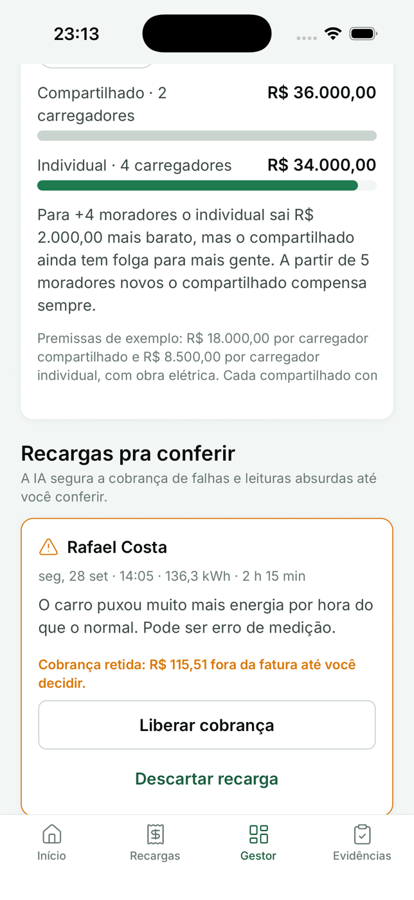</td>
<td valign="top" width="50%"><b>IA 1: decisão do gestor</b><br><sub>Depois de descartar, a recarga sai dos totais: o faturado voltou de R$ 2.683,84 para R$ 2.568,34 e a energia de 3.313 para 3.177 kWh.</sub><br>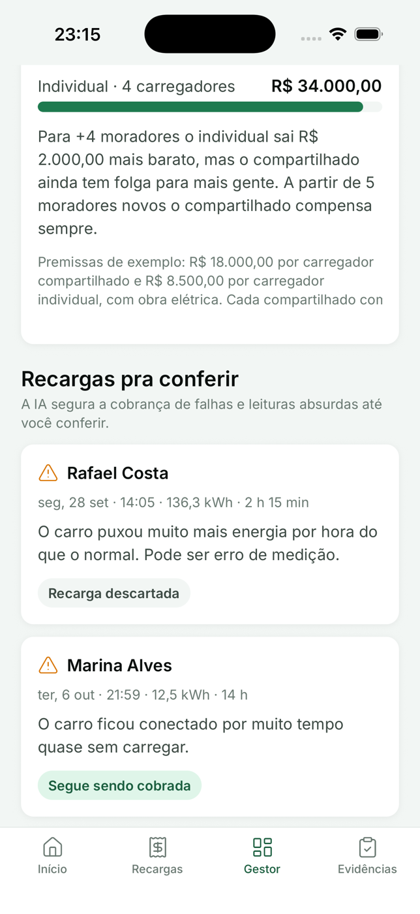</td>
</tr>
<tr>
<td valign="top" width="50%"><b>IA 2: perfis e quem puxa da rede</b><br><sub>Moradores agrupados pelo jeito de usar (K-Means) e a parcela de energia da rede de cada perfil, para direcionar o incentivo ao horário solar.</sub><br>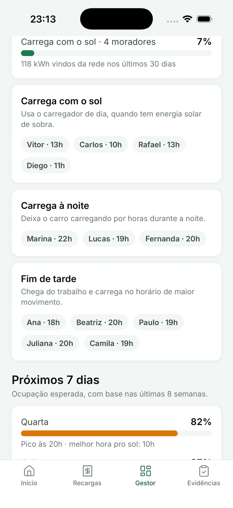</td>
<td valign="top" width="50%"><b>IA 3: previsão de 7 dias</b><br><sub>Ocupação esperada, pico e melhor hora para carregar com o sol. É a mesma previsão que vira a dica do morador.</sub><br>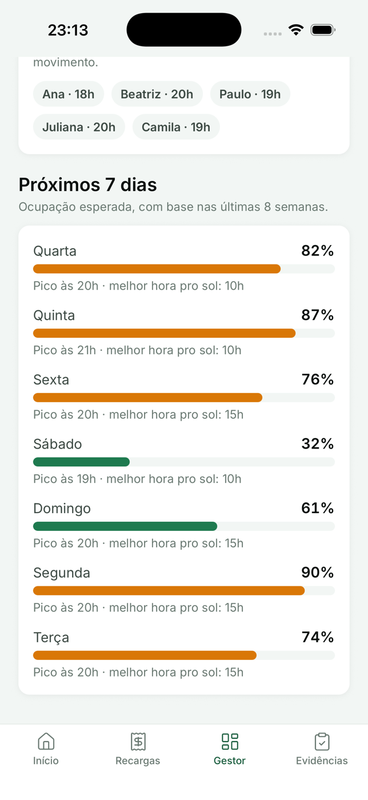</td>
</tr>
</table>

---

# Documentação da Sprint 01

Texto entregue na Sprint 01, atualizado com a abordagem de ecossistema GoodWe. As seções abaixo descrevem o problema, o contexto regulatório e técnico e a arquitetura planejada. Os desvios do planejado estão na seção 7 acima.

## 1. O Problema e a Oportunidade

### 1.1 Veículos elétricos crescendo, recarga privada sem gestão

Segundo a ABVE, foram emplacados 705.648 veículos eletrificados desde 2012 até março de 2026, com 2025 sendo o ano recorde (223.912 emplacamentos) e 2026 já superando esse ritmo com 83.947 unidades nos três primeiros meses. São Paulo lidera com 181.305 veículos eletrificados ativos.

A maior parte da demanda por recarga acontece em ambientes privados — condomínios, edifícios corporativos e campi — e não em eletropostos públicos (16.880 públicos e semipúblicos em setembro de 2025).

### 1.2 A brecha: milhões de prédios com solar, quase nenhum com recarga integrada

- O Brasil tem **mais de 327 mil condomínios** e cerca de 39 milhões de moradores — um mercado que busca reduzir custo de energia, mas trava em assembleia para investir.
- O país já soma **4,3 milhões de sistemas solares de geração distribuída**, 84% deles em residências.
- A GoodWe acaba de firmar parceria no Brasil (RB Solar) para empurrar **inversores híbridos + armazenamento** como pacote completo, dentro de uma estratégia de Energy-as-a-Service.

> Fontes: Cenário Energia (jul/2026) e TN Petróleo — ver seção 9. Os números são de terceiros e devem ser revalidados antes da apresentação final.

Ou seja: **muitos prédios já têm solar, mas quase nenhum tem um carregador de EV integrado a ela de forma inteligente.** O HCA G2 é a ponta desse ecossistema — porém hoje é vendido como item isolado, sem software que mostre por que vale comprar o pacote inteiro.

### 1.3 O caso real: o HCA G2 da FIAP

A GoodWe mantém no campus da FIAP (Energy Innovation Lab — Unidade 2, Aclimação) um carregador HCA G2 no estacionamento L1. O equipamento é real, gera dados a cada sessão e não possui hoje nenhum sistema que os transforme em inteligência: não há histórico por usuário, cálculo de consumo individual, rateio automatizado, nem interface para o gestor. Como o Energy Innovation Lab possui infraestrutura fotovoltaica GoodWe, o campus é o ambiente ideal para demonstrar o conceito completo.

### 1.4 O que a GoodWe tem, o que falta, e o que o EV ChargeOps faz

| O que a GoodWe tem | O que falta | O que o EV ChargeOps faz |
|---|---|---|
| Inversor solar + bateria + carregador | Software que conecte os três e mostre valor conjunto | Integra geração, bateria e sessão de recarga em um só painel |
| Base instalada solar no país | Motivo para o prédio adicionar um carregador GoodWe | O carregador vira o "pretexto" para adotar o ecossistema completo |
| Estratégia Energy-as-a-Service | Produto SaaS recorrente sobre o hardware | Assinatura/rateio do app gera receita mensal sobre carregador já vendido |
| Dados de geração e consumo isolados por dispositivo | Visão unificada para evoluir produto e futura VPP | Cada sessão vira dado de comportamento para a GoodWe |

**A brecha não é "mais um dashboard". É transformar o carregador no produto de entrada que puxa a venda do inversor e da bateria GoodWe.**

### 1.5 Pitch em três camadas

1. **Para o morador:** "Seu carro foi carregado pelo sol do seu prédio — e você economizou R$ X."
2. **Para o condomínio:** "Rateio justo, sem briga, e um motivo claro para investir em solar + bateria."
3. **Para a GoodWe:** "O carregador deixa de ser hardware isolado e vira a porta de entrada para vender inversor, bateria e SaaS recorrente."

---

## 2. A Solução: Fundação + Diferencial

### 2.1 Fundação (backoffice obrigatório)

- Cadastro de usuários e RFID
- Registro de sessões via API SEMS
- Cálculo de kWh individual
- Rateio proporcional por kWh + demanda
- Fluxo sessão → fatura
- Painel do gestor e app do usuário
- IA aplicada (anomalias, clustering, previsão)

### 2.2 Diferencial: "De onde veio a energia do meu carro hoje?"

Para cada sessão, o app exibe a origem da energia em um badge simples:

| Origem | Exemplo exibido |
|---|---|
| **Solar** | "17 kWh vieram do sol do seu prédio" |
| **Bateria** | "5 kWh vieram da bateria GoodWe" |
| **Rede** | "3 kWh vieram da rede (R$ X,XX)" |

É uma feature **tátil**: o morador abre o app e vê, em 2 segundos, que o carro foi abastecido pelo sol e quanto economizou. Dos concorrentes mapeados (seção 3.4), nenhum apresenta isso de forma integrada.

### 2.3 Por que isso vende para a GoodWe

O badge **só funciona se o prédio tiver inversor + bateria GoodWe**. O app cria um argumento comercial direto:

> "Quer que seus moradores vejam o carro sendo carregado pelo sol? Então adote o pacote GoodWe completo."

Isso reforça a lógica de ecossistema que a GoodWe defende globalmente: conectar geração, armazenamento, carga e inteligência.

### 2.4 Como a origem da energia é calculada

O HCA G2 opera em três modos: **Fast** (rede + PV + bateria), **PV Priority** (excedente solar primeiro) e **PV + Battery Priority** (máximo aproveitamento local). Para estimar a origem de cada kWh:

1. A cada ciclo de polling, o Collector lê o fluxo de potência da planta (geração PV, carga, bateria, rede) e a potência do carregador.
2. Para cada intervalo `t` da sessão, a potência do carregador é atribuída às fontes em cascata, conforme o modo de carga configurado (ex.: PV Priority → solar disponível, depois bateria, depois rede).
3. Os kWh por fonte são integrados ao longo da sessão e gravados em `session_energy_sources`.
4. O custo evitado é `kWh_solar × tarifa_kWh` (e analogamente para bateria, descontada a política de uso).

**Premissa a validar no piloto:** a atribuição é uma **estimativa por balanço de potência**, não uma medição física por elétron. A precisão depende da resolução temporal dos dados SEMS e da disponibilidade de leitura do inversor/medidor via API. Quando só há dados do carregador (sem inversor GoodWe), o badge não é exibido — comportamento intencional, pois é o gancho comercial da seção 2.3.

---

## 3. Contexto e Base de Mercado

### 3.1 Infraestruturas de recarga compartilhada

Conjunto de carregadores em área comum, acessados por múltiplos usuários que dividem a infraestrutura e, em geral, a fatura de energia. Desafios comuns:

- **Ausência de medição individual:** a fatura chega ao condomínio como um todo.
- **Conflitos de agenda:** mais veículos do que pontos de recarga.
- **Falta de visibilidade:** o gestor não sabe se o carregador está em uso, com falha ou ocioso.
- **Cobrança manual e imprecisa:** gera atrito entre moradores.
- **Escalabilidade:** novos carregadores sem sistema de gestão multiplicam o problema.
- **Falta de motivação para investir:** sem ver o retorno, o condomínio não aprova solar + bateria.

### 3.2 O que acontece em uma sessão de recarga

1. **Conexão:** o carregador detecta o veículo via Control Pilot (IEC 61851).
2. **Autenticação:** RFID, app (SEMS+) ou plug-and-charge.
3. **Negociação de potência:** o carregador informa a corrente disponível; o veículo aceita ou pede menos.
4. **Transferência de energia:** o carregador mede kW e integra kWh.
5. **Encerramento:** o carregador registra fim, duração e energia entregue.

Dados por sessão: `timestamp_início`, `timestamp_fim`, `duração`, `energia (kWh)`, `potência média`, `potência de pico`, `token de autenticação`, `status de encerramento`.

### 3.3 Modelos de negócio para recarga compartilhada

| Modelo | Descrição | Adequado para |
|---|---|---|
| Gratuito | Custo vai para a conta comum | Frotas corporativas pequenas |
| Cobrança por kWh | Paga pelo volume consumido | Mais justo; exige sub-medição |
| Cobrança por tempo | Tarifa por minuto conectado | Simples, mas injusto |
| Assinatura mensal | Taxa fixa com limite de kWh | Previsibilidade para o gestor |
| Rateio condominial | Custo dividido pela proporção de uso | Campus/condomínios com CNPJ único |

### 3.4 Análise de concorrentes

**Neocharge** — foco em condomínios e frotas; monitoramento em tempo real, relatórios, RFID/app, OCPP 1.6. Limitação: o rateio depende de integração manual com a administração; não gera fatura por unidade.

**ChargePoint** — mais de 35 mil pontos gerenciados; relatórios por sessão, faturamento por kWh/tempo, API REST. Limitação: custo alto de hardware e nenhum suporte ao rateio condominial brasileiro.

**Zaptec** — load balancing dinâmico para edifícios; cobrança por kWh individual. Limitação: sem presença comercial estabelecida no Brasil.

**Ollem, VeVolt, Use Energia, Tupi** — players brasileiros mapeados na pesquisa da Sprint 01 (análise detalhada a incluir na Sprint 02). Nenhum apresenta a origem da energia (solar/bateria/rede) por sessão integrada ao rateio.

**Diferencial do EV ChargeOps:** (1) origem da energia por sessão, ancorada no ecossistema GoodWe; (2) rateio automático por unidade; (3) IA como componente ativo (anomalias, perfis, previsão); (4) integração nativa com a API SEMS, que plataformas genéricas não endereçam.

---

## 4. Base Regulatória e Técnica

### 4.1 Resolução Normativa ANEEL nº 1.000/2021

Consolidou 61 normas anteriores, incluindo a RN 819/2018 (primeira regulamentação de recarga de VE). O Capítulo V trata das instalações de recarga.

- **Exploração comercial permitida:** preços livremente negociados (Art. 9º da RN 819/2018, mantido) — valida a cobrança por kWh.
- **Comunicação prévia à distribuidora:** o Art. 550 exige comunicação quando a instalação altera o nível de tensão ou gera demanda significativa. Para um HCA G2 (máx. 22 kW) no campus, verificar com a Enel SP.
- **Protocolos abertos:** exigidos para equipamentos não exclusivos de uso privado; o HCA G2 suporta OCPP 1.6.
- **Vedação à injeção na rede:** V2G não é regulamentado no Brasil.

### 4.2 Carregador GoodWe HCA G2 — Interfaces

- **RS-485:** comunicação com inversores fotovoltaicos GoodWe e medidores MID — base para ler o fluxo solar/bateria.
- **LAN (Ethernet):** conexão cabeada estável.
- **Wi-Fi:** comunicação com roteador e, via internet, com o SEMS.
- **Bluetooth:** configuração inicial via SolarGo; irrelevante para integração contínua.
- **RFID:** identifica o usuário sem necessidade de app.

Modos de carga: Fast, PV Priority, PV + Battery Priority.

### 4.3 API GoodWe SEMS — Exploração

Acesso via SEMS Portal (semsportal.com / semsplus.goodwe.com). Não há documentação pública completa; a API foi mapeada pela comunidade (Home Assistant, Node-RED).

**Autenticação:** token via CrossLogin.

```
POST https://www.semsportal.com/api/v1/Common/CrossLogin
Header: Token: {"version":"v2.1.0","client":"ios","language":"en"}
Body: {"account": "<email>", "pwd": "<senha>"}
```

O token retornado vai (em Base64) no header das requisições seguintes.

**Endpoints identificados para o EV Charger:**

```
GET https://semsportal.com/powerstation/EvChargerDetail?stationId={station_id}
GET https://www.semsportal.com/api/v3/EvCharger/GetCurrentChargeinfo
GET https://eu.semsportal.com/api/v4/EvCharger/GetEvChargerMoreView
```

**Estrutura de resposta (exemplo):**
```json
{
  "hasError": false,
  "code": 0,
  "msg": "Successful",
  "data": {
    "evChargerStatus": 2,
    "power": 7.2,
    "totalEnergy": 145.8,
    "sessionEnergy": 12.4,
    "sessionDuration": 98
  }
}
```

**Para a origem da energia (a explorar na Sprint 02):** além dos endpoints do carregador, será necessário ler o fluxo de potência da planta (geração PV, carga, bateria, rede) pelos endpoints de detalhe da usina SEMS. Essa leitura ainda **não foi validada** no equipamento da FIAP e é o principal risco técnico do diferencial.

**Limitação crítica:** a documentação oficial é restrita a contas organizacionais SEMS (Open API) ou parceiros licenciados. O piloto usará a conta SEMS vinculada ao equipamento da FIAP, com a API não documentada como fallback de prototipação.

### 4.4 APIs complementares

- **Open Charge Map:** `GET https://api.openchargemap.io/v3/poi/?output=json&countrycode=BR&maxresults=100` — contexto geográfico e comparação de tarifas.
- **ANEEL Open Data:** `dadosabertos.aneel.gov.br` — tarifas por distribuidora (Enel SP) via CKAN, para atualizar a tarifa base do rateio e o valor da economia solar.

---

## 5. Arquitetura e IA

### 5.1 Camadas

**Camada Física** — HCA G2 (e, onde existir, inversor/bateria GoodWe) no estacionamento L1. Gera eventos de sessão, leituras de potência e autenticação RFID.

**Camada de Conectividade** — LAN/Wi-Fi até o SEMS Portal. O EV ChargeOps acessa via API SEMS (polling configurável). OCPP 1.6 é alternativa local, sem depender da nuvem GoodWe.

**Camada de Aplicação (Back-end)** — Node.js: coleta SEMS (carregador **e fluxo de energia da planta**), persiste sessões, **atribui a origem da energia por sessão**, executa o rateio mensal, aciona a IA, expõe API REST.

**Camada de IA** — módulo Python independente (anomalias, clustering, previsão).

**Camada de Apresentação**
- **Painel do gestor:** sessões, consumo por período, alertas, fatura por usuário, indicadores de uso e **percentual solar/bateria/rede do prédio**.
- **App do usuário:** histórico, fatura, agendamento, notificações e **badge de origem da energia por sessão**.

### 5.2 Fluxo de dados — da sessão à fatura

```
[Veículo conectado]
        |
        v
[HCA G2 registra sessão] ---- [Inversor/bateria GoodWe registram fluxo de potência]
        |                                   |
        v                                   v
[SEMS Portal recebe dados via LAN/Wi-Fi]
        |
        v
[EV ChargeOps coleta via API SEMS (polling 60s)]
        |
        v
[Persistência: sessions + plant_power_samples]
        |
        v
[Atribuição de origem por sessão]
    solar_kwh + battery_kwh + grid_kwh = energy_kwh
        |
        v
[Fim do ciclo mensal]
        |
        v
[Motor de rateio calcula fatura por usuário]
    base: Σ energy_kwh × tarifa_kwh + Σ demanda_pico × fator_demanda
        |
        v
[Módulo IA analisa padrões e anomalias]
        |
        v
[Fatura + economia solar disponíveis no app]
        |
        v
[Gestor aprova e envia para cobrança]
```

### 5.3 Papel da IA

**IA 1 — Detecção de anomalias.** Sessões de duração atípica, consumo incompatível ou interrupções anormais indicam falha, uso indevido ou erro de medição. Técnica: Isolation Forest (ou LSTM Autoencoder). Dados: histórico de sessões (mín. 30 dias). Também sinaliza inconsistência entre soma das fontes e `energy_kwh`, que invalida o badge de origem.

**IA 2 — Clustering de perfis de uso.** K-Means ou DBSCAN sobre features por usuário (horário, duração, frequência, energia média). Dados: mín. 60 dias. Gera perfis como "noturno intensivo" ou "recarga rápida esporádica" — e identifica quem poderia migrar para horário de sol, aumentando a fração solar.

**IA 3 — Previsão de demanda e de oferta solar.** Regressão com features temporais ou Prophet. Previsão de ocupação para 7 dias com intervalo de confiança; cruzada com previsão de geração, sugere janelas de recarga com mais energia solar.

### 5.4 Modelo de rateio

Foi adotado o **rateio proporcional por kWh com componente de demanda**, em vez do igualitário (injusto: quem carregou 5 kWh pagaria o mesmo que quem carregou 80 kWh).

```
Fatura_usuário = (energy_kwh_usuário / energy_kwh_total) × custo_energia_mês
              + (peak_kw_usuário / peak_kw_total) × custo_demanda_mês
              + taxa_fixa_plataforma
```

- `energy_kwh_usuário`: energia consumida pelo usuário no mês
- `energy_kwh_total`: soma de todos os usuários no ciclo
- `custo_energia_mês`: custo da energia do período (**neste modelo, apenas a parcela vinda da rede e da bateria; ver abaixo**)
- `peak_kw_usuário` / `peak_kw_total`: pico individual e soma dos picos (proxy de contribuição na demanda)
- `custo_demanda_mês`: parcela de demanda da fatura, quando aplicável
- `taxa_fixa_plataforma`: custo da plataforma dividido entre usuários ativos

**Efeito da origem da energia no rateio (proposta, a validar com o condomínio):** a energia solar tem custo marginal próximo de zero. A decisão de repassar ou não essa economia ao morador é uma política do condomínio. A plataforma suporta duas configurações: (a) tarifa única por kWh; (b) tarifa diferenciada por origem (`tarifa_solar`, `tarifa_bateria`, `tarifa_rede`). A segunda é o que torna a economia visível e atrativa para o morador.

**Casos excepcionais:**
- Sessão `interrupted`: entra no rateio pelo kWh efetivamente entregue.
- Usuário sem recarga no mês: não aparece na fatura nem paga taxa fixa.
- Dois veículos da mesma unidade: cada RFID é um usuário; a fatura da unidade soma os dois.

### 5.5 Esquema do banco de dados

```sql
CREATE TABLE users (
  id          UUID PRIMARY KEY DEFAULT gen_random_uuid(),
  name        TEXT NOT NULL,
  email       TEXT UNIQUE NOT NULL,
  unit        TEXT,              -- ex: "Bloco A - Vaga 12" ou "FIAP - Sala 201"
  rfid_token  TEXT UNIQUE,
  created_at  TIMESTAMPTZ DEFAULT NOW()
);

CREATE TABLE sessions (
  id              UUID PRIMARY KEY DEFAULT gen_random_uuid(),
  user_id         UUID REFERENCES users(id),
  charger_id      TEXT NOT NULL,          -- serial number do HCA G2
  start_at        TIMESTAMPTZ NOT NULL,
  end_at          TIMESTAMPTZ,
  energy_kwh      NUMERIC(8,3),
  peak_power_kw   NUMERIC(6,3),
  avg_power_kw    NUMERIC(6,3),
  charge_mode     TEXT,                   -- fast | pv_priority | pv_battery_priority
  status          TEXT DEFAULT 'completed', -- completed | interrupted | error
  raw_sems_data   JSONB
);

-- NOVO: amostras de fluxo de potência da planta (geração, bateria, rede)
CREATE TABLE plant_power_samples (
  id              BIGSERIAL PRIMARY KEY,
  station_id      TEXT NOT NULL,
  sampled_at      TIMESTAMPTZ NOT NULL,
  pv_power_kw     NUMERIC(8,3),
  battery_power_kw NUMERIC(8,3),          -- + descarga | - carga
  grid_power_kw   NUMERIC(8,3),           -- + importação | - exportação
  load_power_kw   NUMERIC(8,3),
  charger_power_kw NUMERIC(8,3)
);

-- NOVO: origem da energia de cada sessão (alimenta o badge)
CREATE TABLE session_energy_sources (
  session_id      UUID PRIMARY KEY REFERENCES sessions(id),
  solar_kwh       NUMERIC(8,3) NOT NULL DEFAULT 0,
  battery_kwh     NUMERIC(8,3) NOT NULL DEFAULT 0,
  grid_kwh        NUMERIC(8,3) NOT NULL DEFAULT 0,
  grid_cost_brl   NUMERIC(8,2),
  savings_brl     NUMERIC(8,2),           -- economia vs. 100% rede
  method          TEXT DEFAULT 'power_balance', -- método de atribuição
  computed_at     TIMESTAMPTZ DEFAULT NOW()
);

CREATE TABLE billing_cycles (
  id              UUID PRIMARY KEY DEFAULT gen_random_uuid(),
  period_start    DATE NOT NULL,
  period_end      DATE NOT NULL,
  total_kwh       NUMERIC(10,3),
  total_cost_brl  NUMERIC(10,2),
  tariff_kwh      NUMERIC(6,4),
  status          TEXT DEFAULT 'open'     -- open | closed | paid
);

CREATE TABLE invoices (
  id              UUID PRIMARY KEY DEFAULT gen_random_uuid(),
  cycle_id        UUID REFERENCES billing_cycles(id),
  user_id         UUID REFERENCES users(id),
  energy_kwh      NUMERIC(8,3),
  solar_kwh       NUMERIC(8,3),           -- NOVO
  energy_cost_brl NUMERIC(8,2),
  demand_cost_brl NUMERIC(8,2),
  platform_fee    NUMERIC(6,2),
  savings_brl     NUMERIC(8,2),           -- NOVO
  total_brl       NUMERIC(8,2),
  generated_at    TIMESTAMPTZ DEFAULT NOW(),
  status          TEXT DEFAULT 'pending'  -- pending | sent | paid
);
```

**Registros simulados:**
```json
// Sessão com origem da energia
{
  "session_id": "a1b2c3d4-...",
  "user_id": "u001",
  "charger_id": "GW22K-HCA-20-BR001",
  "start_at": "2026-06-10T10:15:00Z",
  "end_at": "2026-06-10T13:45:00Z",
  "energy_kwh": 25.0,
  "charge_mode": "pv_battery_priority",
  "sources": { "solar_kwh": 17.0, "battery_kwh": 5.0, "grid_kwh": 3.0 },
  "status": "completed"
}

// Mensagem exibida no app
{
  "headline": "17 kWh vieram do sol do seu prédio",
  "battery": "5 kWh vieram da bateria GoodWe",
  "grid": "3 kWh vieram da rede",
  "savings_brl": "valor calculado a partir da tarifa vigente"
}
```

---

## 6. Diagrama de Arquitetura (planejado na Sprint 01)

A imagem em PNG está no repositório: `Diagrama arquitetura.png` (a atualizar com a leitura de fluxo da planta e o módulo de atribuição de origem).

```
┌─────────────────────────────────────────────────────────────────┐
│                        CAMADA FÍSICA                            │
│   HCA G2  +  Inversor híbrido GoodWe  +  Bateria GoodWe         │
│        RS-485 | LAN | Wi-Fi | RFID | Bluetooth                  │
└───────────────────────────┬─────────────────────────────────────┘
                            │ LAN / Wi-Fi
                            ▼
┌─────────────────────────────────────────────────────────────────┐
│                    CAMADA DE CONECTIVIDADE                       │
│                  GoodWe SEMS Portal (nuvem)                     │
└───────────────────────────┬─────────────────────────────────────┘
                            │ REST API (polling 60s)
                            ▼
┌─────────────────────────────────────────────────────────────────┐
│                    CAMADA DE APLICAÇÃO                           │
│  ┌─────────────────┐    ┌──────────────────────────────────┐   │
│  │  Collector      │    │        API REST (Node.js)         │   │
│  │  sessões +      │───▶│  /sessions /invoices /users       │   │
│  │  fluxo planta   │    │  /analytics /billing /sources     │   │
│  └────────┬────────┘    └──────────────────────────────────┘   │
│           ▼                                                     │
│  ┌─────────────────┐                                           │
│  │ Atribuição de   │  solar / bateria / rede por sessão        │
│  │ origem (NOVO)   │                                           │
│  └────────┬────────┘                                           │
│           ▼                                                     │
│  ┌──────────────────────────────────────────────────────────┐  │
│  │              PostgreSQL (Supabase)                        │  │
│  │ users|sessions|plant_power_samples|session_energy_sources │  │
│  │ billing_cycles|invoices                                   │  │
│  └──────────────────────────────────────────────────────────┘  │
│           ▼                                                     │
│  ┌─────────────────┐                                           │
│  │  Módulo IA      │  Anomalias | Clustering | Previsão        │
│  └─────────────────┘                                           │
└───────────────────────────┬─────────────────────────────────────┘
                            ▼
┌─────────────────────────────────────────────────────────────────┐
│                   CAMADA DE APRESENTAÇÃO                         │
│   ┌─────────────────────┐    ┌─────────────────────────────┐   │
│   │   Painel do Gestor  │    │      App do Usuário          │   │
│   │   (React / Next.js) │    │   (React Native / Expo)      │   │
│   │   % solar do prédio │    │   Badge: sol / bateria / rede│   │
│   └─────────────────────┘    └─────────────────────────────┘   │
└─────────────────────────────────────────────────────────────────┘
```

---

## 7. Plano para a Sprint 02 (como foi planejado na Sprint 01)

**Fase 1 — Infraestrutura e coleta (semanas 1–2)**
- Banco PostgreSQL (Supabase) com o esquema da seção 5.5
- Collector: autentica no SEMS, faz polling de 60s e persiste sessões
- **Validar quais endpoints SEMS expõem o fluxo de potência da planta (PV, bateria, rede)** — risco principal do diferencial
- Endpoints básicos: `GET /sessions`, `GET /users`, `POST /sessions`

**Fase 2 — Rateio, origem da energia e back-end (semanas 3–5)**
- Motor de rateio (job agendado/RPC) e endpoints de billing
- **Algoritmo de atribuição solar/bateria/rede** por balanço de potência, com testes sobre dados simulados e reais
- Painel do gestor: sessões do dia, consumo, status do carregador, % solar

**Fase 3 — IA, app e pitch (semanas 6–10)**
- Isolation Forest (anomalias) e K-Means (perfis)
- **App do usuário com o badge "De onde veio a energia do meu carro?"**, histórico e fatura
- Integração dos insights de IA no painel
- Vídeo pitch com demonstração do badge no HCA G2 da FIAP

**Plano B:** se a API SEMS não expuser o fluxo da planta com resolução suficiente, a Sprint 02 demonstra o badge com dados simulados de planta sobre sessões reais, documentando claramente a limitação.

**Stack:**
- Back-end: Node.js + TypeScript + Fastify
- Banco: PostgreSQL (Supabase)
- IA: Python + scikit-learn + Prophet
- Front-end gestor: React + Next.js
- App usuário: React Native + Expo
- Deploy: Fly.io (back-end e IA) + Vercel (front-end)
- Observabilidade: Datadog para o Collector

---

## 8. Riscos e Premissas

| Risco / premissa | Mitigação |
|---|---|
| API SEMS não documentada e restrita a contas organizacionais | Conta SEMS da FIAP; fallback de prototipação; contato com a GoodWe para Open API |
| Fluxo da planta pode não estar disponível via API na resolução necessária | Plano B com dados simulados, deixando explícito na demonstração |
| Origem da energia é estimativa por balanço de potência | Documentar o método (`method`) e exibir como "estimado" quando aplicável |
| Dados de mercado (327 mil condomínios, 4,3 M de sistemas) vêm de reportagens | Revalidar com fontes primárias (ABSOLAR, ANEEL) antes da apresentação |
| Diferencial só se aplica a prédios com inversor/bateria GoodWe | É intencional: é o gancho comercial para a GoodWe |

---

## 9. Fontes Consultadas

- ABVE. Dados de emplacamentos de veículos eletrificados no Brasil 2025–2026. abve.org.br
- Canal VE. Frota de eletrificados no Brasil ultrapassa 700 mil unidades. Abr/2026.
- Reconecta News. Veículos eletrificados no Brasil podem chegar a 300 mil vendas em 2026. Mar/2026.
- Cenário Energia. Condomínios atraem fundos de private equity para consolidação da energia solar. Jul/2026. cenarioenergia.com.br
- TN Petróleo. GoodWe e RB Solar anunciam parceria estratégica para acelerar a transformação energética no Brasil. tnpetroleo.com.br
- ANEEL. Resolução Normativa nº 1.000/2021. gov.br/aneel
- ANEEL. Da instalação de estação de recarga (RN 819/2018). aneel.gov.br
- GoodWe. HCA G2 Series EV Charger — Datasheet e User Manual V1.5, 2025. goodwe.com
- GoodWe. API Technical Document (SA-E-20221031-001). community.goodwe.com
- Karunanayake, B. Accessing GoodWe SEMS Portal API: A Comprehensive Guide. Medium, 2024.
- GitHub: TimSoethout/goodwe-sems-home-assistant — endpoints da API EV Charger.
- NeoCharge. Plataforma de Gestão de Recarga. neocharge.com.br
- Energisa. NDU 042 — Fornecimento de energia para estações de recarga de VE. Fev/2025.
- Open Charge Map API. openchargemap.org/site/develop
- VoltBras. Legislação brasileira sobre eletropostos. Fev/2026.
